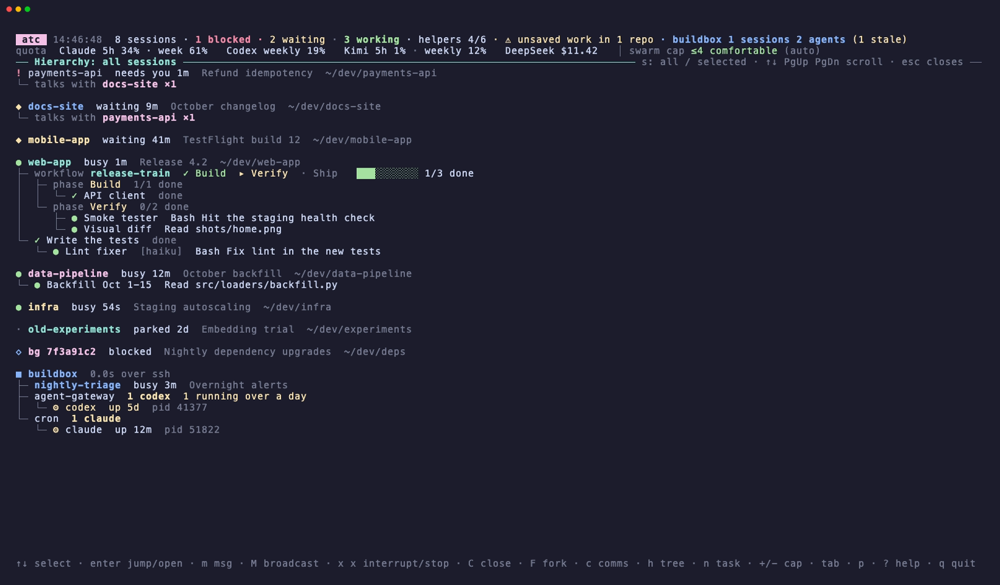
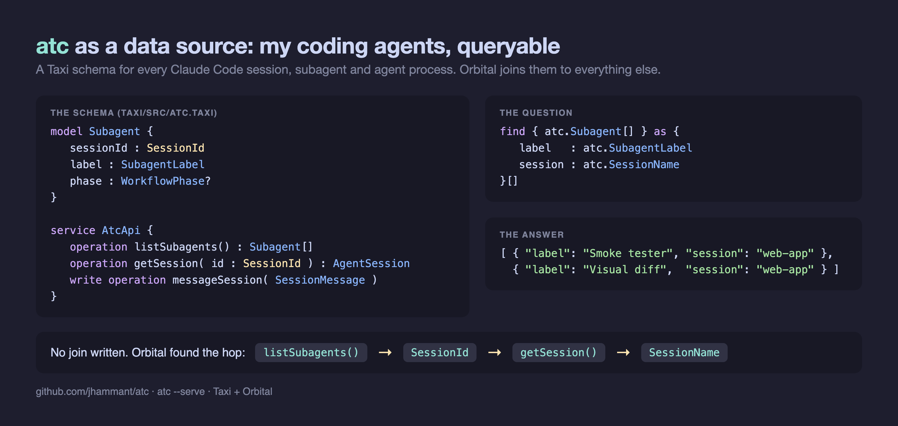

# atc

**Air traffic control for your coding agents.** One terminal screen for every Claude Code session, subagent,
workflow and agent process on your Mac and your servers, with the levers to steer them.

The intro page: [jhammant.github.io/atc](https://jhammant.github.io/atc/)


<sub>Demo data. Arrow into a subagent, drill in, then the hierarchy and comms views.</sub>

## Why

Run a few Claude Code sessions at once, each fanning out subagents and workflows, add a Codex or Kimi job
and an agent on a server, and you lose track: which one is stuck on a permission prompt, which finished an
hour ago and is waiting for you, which background process has been running for five days. `atc` reads what
the agents already write to disk, puts it on one screen, and lets you act on it without hunting for the tab.

## What it shows

- **Blocked on you**: sessions sitting on a permission prompt or a question, and what they are asking
- **Waiting on you**: sessions that finished their turn, with the first line of what they said
- **Working**: what each busy session is doing now, its workflow phases and progress, its subagents, and any
  agent processes it started (`codex`, `kimi`, `claude -p` …)
- **Route swarms**: each `route swarm`, its Codex/Kimi/Claude units, their states, and the latest a-mail to its hub
- **Parked / background / other**: sessions open but idle for 12h+, `claude --bg` sessions, and sessions with
  only a shell running. Listed by default, so nothing open is invisible; `p` folds them away
- **Unsaved work**: each session's repo, checked in the background: uncommitted files, and commits that are on no
  remote yet, so a session isn't closed (or a laptop wiped) with work that only exists on disk
- **Other agents**: agent CLIs running outside any session, with what started them and a `stale?` flag after a day
- **Your servers**: the same view for every machine in `~/.config/atc/hosts`, over ssh
- **Herdr agents**: when [Herdr](https://herdr.dev) is running, the agents in its panes (Codex, opencode, pi …)
- **Hierarchy** (`h`): session › workflow › phase › agent › nested agent › worker process, who talks to whom,
  and each server's agents grouped by what started them

  
- **Comms** (`c`): every message, in full: session to session (✉), the task a session gave each helper (→),
  the helper's report back (←), transcript a-mail (✉@), and swarm traffic (⇄).
  A-mail is read only from session and helper transcripts, with known addresses resolved to session names and
  matching sends and receipts counted once; no a-mail network access, credentials or CLI are needed.
- **Activity**: one merged log of every tool call across every session and helper
- **Quota** (with [quotamax](https://github.com/jhammant/quotamax)): Claude, Codex, Kimi, DeepSeek, and the
  swarm cap that sessions check before fanning out

## Tools and folder profiles

**7 Tools** shows this machine's user-scope MCP servers, copies running, resident memory (MiB), calls in the
last 7 and 30 days, last use and areas that used them in 30 days. Skills show uses across retained transcript
history and last use, including installed skills with zero uses. These are resource and usage measurements,
not monetary estimates. Low usage is information, not a recommendation to disable a tool.

The scanner reads `~/.claude.json` and Claude transcripts, including subagent transcripts, in a background
thread every 30 seconds. Its in-memory cache tracks file identity, size, mtime and read offsets; unchanged
files are not reparsed, appended records are read incrementally, and replaced/truncated files are recounted.
Restarting atc rebuilds the cache. Partial lines wait for the next poll. Duplicate tool-use ids within a file
count once. Only `mcp__<server>__<tool>` and `Skill` calls count; reading a skill file directly does not.
Areas are `~/dev/<area>` (or the first folder under home/filesystem root), taken from transcript cwd; unknown
folders are labelled unknown. The view remains local even with `--here` or remote hosts configured.

Copies are matched by configured command/arguments under live Claude processes, with npm package paths
recognized after the launcher starts Node. A launcher's child tree contributes RSS to one copy. Ambiguous
matches are excluded; unrecognized launchers can undercount. RSS includes shared pages, so it is not exclusive
physical memory. HTTP/SSE servers have no local server process. Definitions, environment values and headers
never appear in the Tools model or audit log. `--json` and `/api/fleet` include `tools`; the web **Tools** view
is read-only. MCP offers `atc_tools`, `atc_open_skill`, `atc_run_skill` and `atc_restart_server`.

On a skill row, **Enter** opens its `SKILL.md` in a new terminal tab with `less`. **r** offers local idle sessions;
use arrows to choose, Enter to review, then Enter to confirm (Escape cancels). Installed skills are discovered
in user/project `.claude/skills`, `~/.agents/skills` and Claude's installed plugin registry. On a server row,
**x x** sends SIGTERM to its matched copies. The sessions reconnect, or need `/mcp` to reconnect. Actions have
dry runs, use the existing confirmation/audit path, and refuse the calling session unless explicitly allowed
through MCP. Skill runs use `deliver()` and recheck idle/blocked state under its delivery lock. Restarts recheck
command, session ownership and start time against fresh `ps` output; changed processes require a new confirmation.

Profiles are opt-in. Nothing modifies `~/.claude.json`, shell files or the native Claude executable. Create and
review them yourself:

```bash
atc profiles init
atc profiles list
atc profiles which ~/dev/project
atc profiles show base
atc profiles doctor
atc claude --dry-run --resume session-id
```

`init` writes `~/.config/atc/profiles/profiles.json` and one `<name>.json` per starting profile, all mode `0600`
in a `0700` directory. It refuses existing files unless `--force` is supplied. Definitions are copied verbatim
from the current user-scope configuration, including credentials only inside the private profile files.
Only servers that exist are included. The starting set uses a base everywhere; company areas add their work
servers and research tools; personal/family add mail; utilities/homeserver/skills add their workspace tool.
Reusable-idea tools stay in the base. The roadmap's headquarters area also gets its research tool. No prompt
nudges, workspace overrides or credentials are invented: configure area-specific workspaces in the private files
before enabling profiles if your server requires them. Regenerate deliberately when source credentials change.

Edit the index and matching profile files by hand to customize them. Example index (no TOML):

```json
{
  "base": {"folders": ["/"], "servers": ["notes"], "strict": true},
  "project": {"folders": ["~/dev/project"], "servers": ["notes", "search"], "strict": true}
}
```

Longest folder prefix wins on path boundaries, with `~` and symlinks resolved. Equal prefixes use the
alphabetically first profile. Each profile is a complete server list, not an overlay. `show` prints server names
only. `which` explains the selected list; `doctor` lists deleted servers, servers in no profile, and unreadable
or inconsistent files. Profile file server names must agree with the index. Files must be regular, nonsymlink
files with mode `0600`. Malformed/unreadable profiles fall through unchanged.

`atc claude [args...]` finds the real executable on PATH, skipping itself; `ATC_CLAUDE` overrides it. It prepends
`--mcp-config <file>` and, for strict profiles, `--strict-mcp-config`, then preserves the original arguments in
order. `atc claude --dry-run [args...]` prints the shell-quoted argv, never server definitions. The leading
`--dry-run` belongs to atc. `ATC_PROFILES=off`, no match, unavailable profile, `claude mcp ...`, `claude update`,
`--version`/`-v` and `-p`/`--print` all pass through unchanged. This keeps scripts and hooks on the full setup.
Strict profiles also exclude other MCP configuration sources; review the list before enabling them.

To opt in manually, add this zsh function (the updater-managed binary remains untouched):

```zsh
claude() { atc claude "$@"; }
```

Revert for the current shell with `unfunction claude`; remove that line from the shell file for future shells.
Alternatively, `export ATC_PROFILES=off` disables profile selection immediately.

## Levers

The live screen starts with **1 Sessions · 2 Needs · 3 Agents · 4 Jobs · 5 Servers · 6 Quota · 7 Tools**.
Tabs appear when their first content arrives and stay available until you quit; their numbers stay fixed.
Sessions keeps the local session list, swarms, other agents, Later and closed sessions. Needs shows the shared
queue, including approvals. Agents holds hierarchy and comms; Jobs holds jobs and apps; Servers holds each
host's sessions and processes. Quota expands every provider, the swarm cap and its pin, and quotamax's advice.
Tools shows MCP resource use and skill usage. `--json` adds `tools`; `--once`, `--tree` and `--comms` keep their existing output.

Press `:` for the command palette. Type words to filter actions, use arrows to choose, and Enter to run.
For example, `jump beta` finds that session, `message beta` opens its message input, and `run /status` previews
a slash command for the selected idle session, then asks for Enter to confirm. `approve <id>` and `deny <id>`
select a local approval and start the usual two-press confirmation. Escape cancels. Actions use the same
guards and confirmations as their keys, including `--dry-run`.

The footer shows actions for the selected row; `?` shows the full, scrollable help. Each tab remembers its
selection and bottom panel. `h` and `c` open the Agents tab; Escape returns to Sessions. On narrow terminals,
the tab bar scrolls to keep the active tab visible.

| Key | Does |
|---|---|
| `1`–`7` / `←` `→` | Select a tab by its fixed number, or cycle available tabs |
| `:` | Open the command palette; type to filter, `↑` `↓` choose, `enter` runs, `esc` cancels |
| `enter` | Jump to the session's terminal tab (iTerm2, Terminal.app, tmux, Herdr). A background session opens attached in a new tab |
| `enter` on a subagent | Drill in: who started it, its task, every step it took, its report, its own helpers |
| `enter` on a process or server row | Its command, uptime and what started it; on a server's session, an ssh shell there in a new tab |
| `m` | Type a message into the selected session, as if you typed it there. A busy session queues it |
| `M` | The same message to every session in the selected session's project folder |
| `x` `x` | Interrupt the session (Esc). A background session: `claude stop`. An agent process, here or on a server: stop it (SIGTERM, over ssh). A loom job: run it now |
| `C` `C` / `F` `F` | Type `/closecode` or `/forkcode` into the session: wrap it up, or split work off |
| `+` `-` `0` | Raise, lower or reset the swarm cap (`quotamax override`, pinned for 2h by default) |
| `n` | New task: `route --plan-only` says where it should run (Claude, Codex, Kimi …); `enter` dispatches it in a new tab |
| `R` `R` / `D` `D` | Restore a closed session / hide it as done |
| `E` `E` / `S` `S` / `N` `N` | Exit an idle session if its repo is saved / save and close / rename |
| `y` `y` / `n` `n` | Approve / deny a local approval in Needs, on its row or in its detail view |
| `c` / `h` / `s` | Agents: comms / hierarchy / all or selected session |
| `b` | Cycle the bottom panel: activity, selected row detail, comms (wide screens keep comms alongside); `tab` remains an alias |
| `p` | Fold or expand quiet sessions, Later and finished swarms in Sessions; idle jobs in Jobs |
| `PgUp` `PgDn` / `J` `K` | Scroll activity or an open view; scroll the Quota tab |
| `?` / `q` / `esc` | Full help / quit (close an open view first) / close view or cancel input |

**Steering never types into a session that is blocked on a prompt.** A permission prompt's default answer is
"Yes", so a message ending in Enter would approve whatever it was asking. `atc` re-reads the session's state
right before typing and skips it; press `enter` to go and answer the prompt yourself. Sessions in Herdr panes
are steered through `herdr agent prompt`, which has the same guard.
Deliveries to the same terminal or Herdr pane are serialized across threads and local atc processes: each
fresh state check, message and Enter completes before the next delivery checks again. Different targets can
still receive messages in parallel. While a message or project broadcast runs, the footer shows its progress
before reporting all recipients and skips.

## Install

Python 3.9+, standard library only. macOS or Linux.

```bash
git clone https://github.com/jhammant/atc ~/dev/atc
ln -s ~/dev/atc/atc.py ~/.local/bin/atc
atc
```

```bash
atc                  # live view
atc --here           # only sessions in or under this folder: one project's swarm
atc --once           # one frame as text        atc --tree     the hierarchy
atc --comms          # every message            atc --json     the data, for scripts and menu-bar apps
atc --host buildbox  # add a machine for this run (or list them in ~/.config/atc/hosts)
atc --jump <id>      # focus a session's tab    atc --cap up|down|auto   change the swarm cap
atc --jump <id> --tty /dev/ttys003   # focus straight away when you already know the tty (Roost does)
atc --open           # open the live view in a new terminal tab
atc --dry-run        # levers say what they would do instead of doing it
atc --serve          # the fleet as JSON for Orbital / Taxi (see below)
```

### Servers

List ssh targets in `~/.config/atc/hosts`, one per line. `atc` runs itself on each over ssh
(`ssh host python3 - --json < atc.py`), so there is nothing to install there; the host needs Python 3.9+ and
key-based ssh. Two names for one machine are shown once. Server rows can be selected: open a process to see
what started it and stop it with `x x`, or press `enter` on a server's session for an ssh shell there.

### Where new sessions open

New sessions (`n`, attaching a background session, server shells) open in the terminal `atc` runs in. Set
`ATC_TERMINAL` to choose: `iterm`, `terminal`, `tmux` (a window in your current tmux), or `tmux-bg`: windows in
a detached `atc` tmux session you can attach to from anywhere, including over ssh from a phone.

### Optional tools

Used when found on `PATH`; override with `ATC_QUOTAMAX`, `ATC_ROUTE`, `ATC_HERDR`, `ATC_CLAUDE`, `ATC_AMAIL`, `ATC_LOOM`, and `ATC_SSH`
(e.g. `ssh -J bastion`).

- [quotamax](https://github.com/jhammant/quotamax): quota for every provider, and the swarm cap
- `route`: picks where a new task should run
- `amail`: a-mail owner and inbox counts via `amail status --json`; `ATC_AMAIL=` disables it
- `loom`: jobs and apps via its JSON lists; `ATC_LOOM=` disables it
- [Herdr](https://herdr.dev): agents in Herdr panes, steered through Herdr. `atc` only talks to a Herdr
  server that is already running and never starts one, because starting it resumes every saved agent.

### One needs-you queue

The web Needs view, MCP `atc_needs_me`, `--json` (including menu-bar consumers such as Roost), and the terminal
share `needs`. Blocked sessions from every machine come first, then pending lever approvals, a-mail approvals, requests, proposals and
devices awaiting approval, then failing loom jobs, Later items due within an hour, waiting sessions (newest first
across machines), and a-mail inbox waiting.
The terminal's **Needs** tab shows the whole queue in order, with details and a hint about where to answer.
`--once` keeps its session sections, **a-mail** section and short header note. Answer session prompts in that
session, and a-mail items in **Roost or the a-mail app**. Remote approvals show where to decide them;
`y y` and `n n` decide only this machine's approvals.

The public a-mail CLI's `status --json` returns counts without reading or acknowledging messages. atc only
uses those counts; it does not fetch message content or retain the returned server or address. Polls run in the
background every 60 seconds on the screen and under `--serve`, or on demand with a 60-second cache under
`atc mcp`. `--json` and `--once` take one reading. A missing CLI or an initial offline failure is silent. If a
reading worked and later fails, one **a-mail unreachable** item replaces the counts until a reading succeeds.

`--json` adds these fields without changing existing keys:

- `needs`: ordered items with `kind`, `host` (null on this machine, or `local` for loom jobs), `sid` (null except for sessions), `title`,
  `detail`, `since` (seconds in that state; null when unknown), and `hint` (where to answer).
- Kinds today: `blocked`, `waiting`, `amail_approval`, `amail_request`, `amail_proposal`, `amail_device`,
  `amail_inbox`, `amail_unreachable`, `approval`, `job` (also carries its `job` name) and `later`. Consumers
  should render unknown kinds using their title, detail and hint.
- `counts.needs`: number of queue items, including the unreachable note when present. Each nonzero a-mail
  category is one item, with its quantity in the title (`4+` means the inbox has more). `counts.needs_urgent`
  counts blocked sessions, pending lever approvals, and a-mail approvals, requests and devices awaiting approval.
  Failing jobs contribute to `counts.needs` and `counts.jobs_failing`, and use an orange warning signal; they
  do not contribute to `counts.needs_urgent`. Due Later items also count toward `needs`, never `needs_urgent`.

These two counts cover the whole fleet; existing session counts still describe this machine. Sleeping hosts'
cached items stay in the queue and its counts, with a last-seen hint. A host never seen has only a connection
notice. `/api/fleet` exports only this machine's needs and matching local counts; hubs add each host's
non-session items, and build its session items from groups, avoiding duplicates and forwarding loops.

### Needs you later

**Later** is one time-ordered list of session wake-ups, next cron runs and items from your own tools, such as
reminders or study cards. Anything overdue or due within 60 minutes also enters `needs` with kind `later`.
Undated items sort last and stay out of the needs queue. The terminal's Later section follows Waiting and
shows the next 24 hours plus overdue items; `p` expands or folds it alongside Parked. Session rows show
`wakes in 12m`. The web Needs view includes upcoming items, and the **Later** view shows the full list.
MCP `atc_needs_me` adds a short “Later today” preview (the next 24 hours); `atc_later` reads the full list.

atc reads `ScheduleWakeup`, `CronCreate` and `CronDelete` from live session transcripts, never helpers. A new
wake-up replaces the previous one; stopping it or transcript activity after its due time removes it. Cron
expressions have five fields in this machine's local time, with numbers, `*`, lists, ranges and steps. When
both day-of-month and day-of-week are restricted, either may match. Recurring crons advance to their next
run; one-shot crons remain due until subsequent transcript activity. All session schedules disappear when
their session ends. As with other transcript details, startup reads the recent transcript backlog.

Put executables in `~/.config/atc/later.d/`, or set `ATC_LATER_DIR` to another folder (empty disables plug-ins). Each is run directly,
without a shell, in the background every ten minutes, with a 30-second timeout. It prints a JSON array of
items with a `title`, `when` (ISO 8601 or null), `detail`, `kind` and `source`. Prefer explicit time zones;
times without an offset use this machine's local time. For example, save this as `later.d/review`, then
`chmod +x ~/.config/atc/later.d/review`:

```python
#!/usr/bin/env python3
import json
from datetime import datetime, timedelta, timezone
due = datetime.now(timezone.utc) + timedelta(hours=2)
print(json.dumps([dict(title="Review notes", when=due.isoformat(), detail="Study cards", kind="study", source="notes")]))
```

This example always reports two hours from the poll; a real plug-in should read its tool's stored due time.
Plug-in output is data: atc never interprets it as commands or actions. A failing plug-in contributes one
diagnostic in `later_errors` and no items; other plug-ins still work. The diagnostic clears after recovery.
`--json` and `--once` wait for one reading; MCP reads use the same ten-minute cache on demand.

`later` items have `title`, `detail`, `kind`, `source`, `sid` (or null), `host` (or null), `when` (Unix seconds
or null) and `in` (seconds until due, negative if overdue, or null). Session views include `wakes_at`.
`/api/fleet` exports this machine's Later items; hubs merge each host once, set `host`, recalculate `in`, and
mark cached items from unavailable machines as last seen. Due Later items retain their timing and source in
`needs`; `later_kind` preserves their original kind.

### Loom jobs and apps

When `loom` is on `PATH`, **Jobs & apps** appears in the terminal's **4 Jobs** tab, and **Jobs** appears in the
web navigation. Set `ATC_LOOM` to a command override (arguments are supported), or to an empty string to disable
it. Missing loom is silent. Add loom hosts with `ATC_LOOM_HOSTS=server1,server2`; these are separate from atc's
agent hosts and are reached with `loom --host <host> jobs list --json`. Apps come from local `loom list --json`.

Each host lists failing jobs first, then running jobs, then estimated due times. The terminal shows the nearest
due job and folds the remaining healthy idle jobs into one line, including an expired count; `p` toggles those
rows in Jobs. Select a job and press Enter for status and recent logs. `x x` triggers it now.
App rows are also selectable, including those after the last job; Enter shows their cached status, health and URL.
The web Jobs view shows all jobs, links to status, and has **Run now** buttons using the existing preview and confirm
dialog. MCP `atc_jobs` reads the same list; pass `job` and optionally `host` for status. `atc_run_job` accepts the
exact `job` name and an optional `host` (default `local`), and supports confirmation, `dry_run`, and the audit log.
Manual runs are allowed for known expired jobs; expiration excludes them from due estimates.
`--serve --serve-writes --dry-run` keeps web and MCP runs dry, including confirmed or approved requests.

Lists poll every 60 seconds in background threads under the screen and `--serve`, and on demand with a 60-second
cache under `atc mcp`. `--json` and `--once` read once. Hosts and the local app list are read concurrently with
15-second command timeouts. Poll workers are daemon threads, so quitting does not wait for a stalled poll.
An unavailable job list keeps its last rows, marked as last seen; runs are refused until it answers again.
App-list failures are reported separately and leave job status and runs available. Status and run commands also
have a timeout; an uncertain run is never retried.

`jobs` in `--json` and the web model is a map from `local` or a configured loom host to
`{ok, error, jobs, apps, apps_ok, apps_error}`. `ok` and `error` describe the job list; `apps_ok` and `apps_error`
describe the local app list (`apps_ok` is null for remote hosts, where apps are not queried). Job fields come
from loom, plus nullable `next_run` (Unix seconds) and `next_run_iso` (ISO UTC). `counts.jobs_failing`
counts failed jobs across those hosts, including stale rows; each gets a `kind: job` needs item. `/api/fleet`
exports only this atc's own loom readings (`jobs_own`), including its configured `ATC_LOOM_HOSTS`.
Hubs merge peers' jobs into `jobs`, marked with `via` and `via_key` so status and runs reach the owning atc.
Those merged jobs and their needs items are never re-exported to another peer.

Due times read as `in 12m`, `at 08:05` or `tomorrow 01:30` in the terminal, MCP list and web view; JSON keeps machine
timestamps. Clock times use the reading machine's timezone for terminal/MCP and the browser's timezone for web.
These are estimates: intervals use loom's last-log-write timestamp plus the interval, one-shot schedules use
their timestamp, and calendar schedules use the reading machine's timezone. Expired, running and already-run
one-shot jobs have no due estimate. Unknown schedules or intervals with no last run remain idle. Check loom's
status for scheduler details, especially when machines use different timezones.

## Talk to it from Claude (MCP)

`atc mcp` is an [MCP](https://modelcontextprotocol.io) server, and `atc --serve` answers MCP at `POST /mcp` too.
Register it once and any Claude Code session can ask who needs you, what another session is doing or what the
agents are saying, and pull the same levers as the screen, on this machine and on your servers.

```bash
claude mcp add --scope user atc -- atc mcp     # on this machine: stdio, nothing to expose
claude mcp add --transport http --scope user atc https://atc.example.ts.net/mcp \
  --header "Authorization: Bearer <token>"     # from another machine, through atc --serve --serve-writes
```

| Tool | What it does | Same as |
|---|---|---|
| `atc_fleet` | Every session by state (blocked, waiting, working, parked, background, other), swarms, other agents, servers | `atc --once` |
| `atc_needs_me` | The ordered needs-you queue on every machine, including a-mail counts and where to answer | Needs you |
| `atc_later` | Wake-ups, next cron runs and plug-in items, ordered by time across machines | Later |
| `atc_tools` | Local MCP copies, RSS, calls in 7/30 days, areas and skill usage | Tools |
| `atc_open_skill` | Open an installed SKILL.md in a new tab | Enter on a skill |
| `atc_run_skill` | Run a skill in a chosen idle session, with confirmation | `r` on a skill |
| `atc_restart_server` | SIGTERM matched server copies and workers, after rechecking ownership | `x x` on a server |
| `atc_jobs` | Loom jobs and apps, per host; optional job status and recent log | Jobs & apps / Enter |
| `atc_run_job` | Trigger a known loom job now, with confirmation and audit | `x x` on a job |
| `atc_session` | One session: folder, state, what it is doing and said, git, helpers and workflow phases, worker processes, recent steps | `enter`, the bottom panel |
| `atc_tree` | Session › workflow › phase › agent › worker process | `atc --tree`, `h` |
| `atc_comms` | Messages between sessions, tasks to helpers and their reports, swarm a-mail; newest first | `atc --comms`, `c` |
| `atc_quota` | Claude, Codex, Kimi, DeepSeek quota and the swarm cap | the quota line |
| `atc_closed` | Closed sessions you can resume, with their last words and next step | the Closed section |
| `atc_message` | Type a message into a session, as if you typed it there | `m` |
| `atc_broadcast` | The same message to every session in a folder | `M` |
| `atc_interrupt` | Interrupt a session (Esc), or stop a background one | `x x` |
| `atc_stop_process` | Stop an agent process (SIGTERM), here or on a server | `x x` on a process |
| `atc_close` | Wrap a session up with `/closecode`, or `/exit` it when nothing is unsaved | `S S`, `E E` |
| `atc_fork` | Type `/forkcode` into a session | `F F` |
| `atc_rename` | Rename a session (`/rename`) | `N N` |
| `atc_restore` | Reopen a closed session (`claude --resume`) in a new tab | `R R` |
| `atc_cap` | Raise, lower or reset the swarm cap | `+` `-` `0`, `--cap` |
| `atc_new_task` | Where a task should run (`route`); with `pool`, start it there in a new tab | `n` |
| `atc_jump` | Bring a session's terminal tab to the front | `enter`, `--jump` |

A session is named by its id (or the start of it), its name or its title. One on a server takes `host`, or is
written `name@host`.

**Levers keep the screen's rules, and add some for being called by a model:**

- **Never into a session blocked on a prompt.** Its default answer is "Yes"; the message is refused, not typed.
- **You confirm steering.** `message`, `broadcast`, `interrupt`, `stop_process`, `close`, `fork`, `rename`,
  `restore` and a `new_task` with a `pool` ask you first, in the calling session (an MCP elicitation). A client that
  can't ask, or a session nobody is watching, creates a pending owner approval (see below).
  `jump`, `cap` and a `new_task` plan just run.
  `ATC_MCP_LEVERS=auto` drops the question; `ATC_MCP_LEVERS=off` makes MCP read-only.
- **Not into itself.** A lever aimed at the session that called it is refused unless the call says
  `allow_self: true`. Over stdio atc knows the caller from Claude Code's environment; over HTTP, from an
  `X-Atc-Caller: <session id>` header when the client sends one.
- **`dry_run: true`** on any lever says what it would do.
- **Every lever call is logged** to `~/.config/atc/audit.jsonl` (`0600`): when, who called, what, and what
  happened.
- **Servers too.** A lever on a session or process on a server in `~/.config/atc/hosts` runs there over ssh, the
  way atc reads it, so nothing is installed there. Typing needs the session in tmux or Herdr on that machine.
- **Over HTTP the token is always required at `/mcp`**, on this machine too, and levers are listed only with
  `--serve-writes`. A request that arrives through a reverse proxy (`X-Forwarded-For`) counts as off this
  machine for every endpoint.

### Pending approvals

When a steering call cannot ask you in-session (no MCP elicitation, a handshake-era HTTP client, or an
unattended session), atc creates an approval on the machine handling the call. It waits up to 45 seconds:
your approval runs the lever once, and denial refuses it. Set `ATC_APPROVAL_WAIT` to a finite, non-negative
number of seconds to change the wait (default `45`; `0` returns immediately with the pending approval).
If you have not decided yet, the tool returns a non-error **Waiting for approval** result with an ID and expiry.
The approval lasts ten minutes from creation.
After approving, retry the same tool with exactly the same arguments and caller, adding `approval: "<id>"`.
Every lever documents this argument. Before using a grant, atc rebuilds the lever and checks its resolved
summary against the action the owner saw, as well as its tool, arguments and caller. A changed target or folder
(including a different default folder on another transport) requires a new approval: call again without the
`approval` argument. Pending, denied, expired or already-used grants are refused. Calls that can ask you
in-session keep their existing prompts. Dry runs and refusals before a lever is ready do not create approvals.

Grant or deny an approval in any of these places:

- **Web UI, on a phone or laptop:** Needs you shows each approval's summary, caller, machine and expiry.
  **Approve with passkey** needs a fresh passkey assertion with user verification; signing in alone is
  insufficient. **Deny** needs your signed-in session.
- **atc screen on the owning machine:** approvals appear first. Press Enter or `f` on one to read its entire
  summary, caller, target and expiry; arrows and Page Up/Down scroll the wrapped detail. Press `y y` to approve
  or `n n` to deny, on the row or in the detail view. The first press names the target.
- **A terminal on the owning machine:** `atc approvals` lists pending and approved grants;
  `atc approve <id>` and `atc deny <id>` decide pending ones. Both decisions require stdin to be a TTY.

The file `~/.config/atc/approvals.json` has mode `0600`. File locks and an atomic claim before executing make
approvals single-use across processes and concurrent requests. A failed or interrupted lever attempt still
spends its grant; check the target before requesting another. Finished and expired entries are removed ten
minutes after their original expiry; the audit log retains creation, decisions and use. The digest binds the
exact original arguments without storing a second copy of them; the stored summary may contain message text.
A missing caller is bound as missing, so clients should consistently send their session ID.

Optional notifications: set `ATC_NOTIFY_CMD` to a command. atc splits it with `shlex` (no shell) and appends one
argument: `atc: approval waiting: <tool> on <target> (<id>)`. It contains no message body. Command output is
discarded, failures are ignored and execution times out after five seconds. Approvals are urgent items of
kind `approval` in the shared needs queue, `counts.needs_urgent`, `/api/fleet` and `--json` for Roost.

**A laptop that sleeps.** Run a second atc on an always-on server and point it at the laptop's:

```bash
atc --serve 100.64.0.1:7070 --serve-writes                  # the laptop, on its tailnet address
atc --serve 100.64.0.2:7070 --serve-writes \
    --serve-prefer http://100.64.0.1:7070                   # the server: register this one everywhere else
```

The server passes `/mcp` through to the laptop's atc while it answers, so you see everything the laptop sees. When
the laptop sleeps, the server answers itself: its own sessions and servers live, and the laptop as last seen
(read from the laptop's `/api/fleet` while it was awake), with a note saying so. Both read the same token: copy
`~/.config/atc/serve-token` across (`0600`). A tool call that was passed through but got no answer is reported,
never run a second time on the server.

atc speaks protocol `2026-07-28` (stateless; `server/discover`; confirmation by returning `input_required`) and
the handshake revisions `2025-11-25`, `2025-06-18` and `2025-03-26` (`initialize`; confirmation as an
`elicitation/create` request over stdio). Results are plain text, written for a model to read.

## Web interface

Keep an always-on hub behind a TLS reverse proxy on a **private network**, for example a tailnet-only
hostname. Install `openssl` on the hub and keep `web/` next to `atc.py`. There is no build step or CDN.

```bash
atc --serve 127.0.0.1:7070 --serve-writes --web-origin https://atc.example.com
```

Point the proxy at that listener and preserve the browser's `Origin` header. `--web-origin` is the exact
HTTPS origin, with no trailing slash or path; its hostname is the WebAuthn RP ID. Without it, `/` explains
that the web UI is off and `/api/web/*` returns 404. Omit `--serve-writes` for a read-only dashboard.

On the hub, in an interactive terminal, run:

```bash
atc web-enroll
```

Open the HTTPS page, choose **Add your first passkey**, and enter the code and a passkey name. The code is
single use and expires after ten minutes; starting enrollment consumes it, even if you cancel the browser
prompt. Run the command again if needed. Stdin must be a TTY. Face ID, Touch ID or another authenticator
must verify you. Once signed in, the **Passkeys** view adds further passkeys without a code, removes them,
and signs out. Removing the last passkey requires explicit confirmation; recovery uses a new hub code.
Removing a passkey revokes its web sessions. Restarting atc signs every browser out.

**Needs you** comes first: the shared queue of pending approvals, prompts, a-mail owner items, waiting sessions
and inbox counts, including last-seen items from machines that aren't answering. Its badge uses `counts.needs`.
Unavailable machines keep one connection notice with their specific error and last-seen time, even when
their cached items are in the queue. Each queue item names its machine.
**Fleet** groups sessions, helpers, workflow phases, workers, route
swarms and other processes by machine. Open a session for its full last words, git state, recent steps and
messages. Remote session detail uses its fleet snapshot, so it has less detail. **Comms**, **Quota** (including
swarm cap controls), and **Closed** (including Restore) cover the hub's messages, quota and closed sessions.
The page refreshes every five seconds while visible, works on phones, and follows the system color scheme.
If the first connection fails, it shows a retry message and keeps polling, even before sign-in.

Message, Interrupt, Save & close, Exit, Fork, Rename, Jump, Restore and swarm cap changes first run a dry
run. The page shows the tool's own summary and runs it only after you confirm. Existing refusals still
apply, including blocked prompts and unsaved work. Jump focuses the terminal on the session's machine;
it does not turn the browser into a terminal. Save & close sends `/closecode`, whose session workflow can
commit and push work before closing.

### Identity and peer calls

The machine bearer token protects MCP and machine reads. It is **never accepted as web authentication**.
Web tools and data require an in-memory, twelve-hour session from a passkey. The cookie is HttpOnly, Secure
and SameSite=Strict. Every web POST also checks the configured Origin and `X-Atc-Web: 1`. Only the dedicated
`/api/web/auth/{register,login}/{options,finish}` bootstrap endpoints allow unsigned requests; registration
still needs a hub enrollment code or an existing web session. WebAuthn challenges expire after two minutes
and can be used once. Only ES256/P-256 keys are accepted, with user presence and verification required.
OpenSSL (including macOS LibreSSL) verifies signatures; atc checks P-256 public-key points locally. If
OpenSSL is missing, sign-in fails closed. Passkeys, hashed enrollment codes and
identity files live in `~/.config/atc/web/` (0700 directory, 0600 files). Cookies are never stored on disk or
written to the audit log. Sign-in, enrollment, passkey removal and web levers are audited with the passkey
name. Session text is rendered as text, under a policy that allows only same-origin assets and no inline scripts.

To steer a laptop through its HTTP atc, configure **the same separate peer secret on both atc instances**:
`ATC_PEER_TOKEN` or `~/.config/atc/peer-token` (0600). Provision this secret yourself; atc never creates it.
It must differ from `ATC_SERVE_TOKEN`. Keep it out of MCP clients and scripts. Both instances need
`--serve-writes`. For example, the hub can add the laptop through:

```bash
atc --serve 127.0.0.1:7070 --serve-writes --web-origin https://atc.example.com \
  --serve-prefer http://100.64.0.1:7070
```

`--serve-prefer` keeps its existing MCP forwarding behavior. The web UI stays on the hub and sends that
host's levers to `/api/peer/tools/<tool>` using the peer secret, after confirmation on the hub. SSH hosts
still use SSH. Peer calls run the same tools and refusals, with transport `peer`, and are audited on both
sides. A lost response is not retried automatically because the action may already have run. HTTP hosts
poll every five seconds while reachable and every thirty seconds while offline.

Approval assertions use a fresh random challenge bound to the approval ID, argument digest, owning machine
and browser session. A login assertion cannot approve an action, and an action assertion cannot approve
another action. Neither MCP nor the bearer token can grant or deny approvals; there is no approval MCP tool.
For approvals owned by another HTTP atc, the hub relays the verified decision to
`POST /api/peer/approvals/<id>` with the separate peer secret. The body is
`{"decision":"approve","by":{"name":"Phone","hub":"server1"}}` (or `"deny"`). The owning atc makes the
locked transition and audits `via: "web passkey via server1"` for approval, or `web session via server1` for
denial. The owning machine must be reachable; cached approvals cannot be granted while it sleeps.

Bearer tokens are for machines, passkeys are for people, and the peer secret is between atc instances.
The web UI needs HTTPS: WebAuthn requires a secure context and the session cookie is Secure. The backend
listener may use HTTP behind the TLS proxy, confined to loopback or the private network. This does not
sandbox processes running as the hub owner; those processes already control that account.

## Route swarms

Run `route swarm` as usual, then watch it in atc:

```bash
atc                          # Swarms section after Working; enter opens a swarm or unit's details
atc --once                   # states, unit arms and elapsed times, message count and last message
atc --tree                   # owning session > swarm > unit > worker process (h in the TUI)
atc --comms                  # a-mail alongside other messages, marked ⇄ (c in the TUI)
atc --json                   # swarm data for scripts
ATC_SWARM_HOURS=24 atc       # keep finished swarms visible for a day (default: 6 hours)
```

atc reads `swarms/*/status.json` and the adjacent `channel.jsonl` under `$ROUTE_STATE_DIR`, otherwise
`$XDG_STATE_HOME/route`, otherwise `~/.local/state/route`. It supports the `route-swarm-status/1` schema,
re-reads status only when its modification time changes, and tails messages incrementally, keeping up to
200 per swarm. Older runs without a status file are not listed. Swarm monitoring never writes to this state
directory or acts on message text.

Unit marks are queued `○`, running `●`, checking `◐`, accepted `✓`, failed `✗`, and stopped `?`. A running
swarm shows `stopped?` when its route PID disappears or belongs to an unrelated command; a running unit shows
`stopped?` when its PID disappears. Swarms stay visible while their snapshot says running, including stale
ones. Finished swarms remain for `ATC_SWARM_HOURS` after `finished_at`; `p` folds them away with parked sessions.
`--here` and `--only` filter swarms by their repo path.

The hierarchy follows route's parent processes to the nearest known session. Unowned swarms appear under
`route swarms`. Unit processes are labelled `<swarm>/<unit>` in the session's worker data and shown once under
their swarm, rather than again as other agents. Select a swarm or unit and press `enter` to inspect all its
units, log paths, branches, worktrees and held-unit reasons. These details are read-only.

Messages with an unknown `from_unit` appear as `<swarm>/?<address before @>`. They are retained: a-mail can
currently deliver other subagents' traffic to a swarm hub. The comms view preserves the full message body;
the fleet shows a single line cut to the available width.

`--json` adds:

- `swarms`: views containing `id`, `name`, `state`, `stale`, `owner` (session name or null), `age`, `started`,
  `finished`, `exit_code`, `messages`, `last_message` (`from`, `text`, `at`, or null), `units`, and `held`.
- Each unit has `id`, `arm`, `state`, `pid`, `age`, `wall`, `address`, `branch`, `log`, and `worktree`.
- `counts.swarms`: running swarms after the liveness check; `counts.swarm_units_running`: running units after
  their liveness checks. `swarms_unreadable` counts unreadable, malformed and unsupported-schema status files
  in the current scan.
- `comms` includes `kind: "swarm"`, `from: "<swarm>/<unit>"`, `to: "<swarm>/hub"`, `summary`, `body`, and `ts`.

Times (`started`, `finished`, `last_message.at`, `comms.ts`) are Unix seconds or null; `age` and `wall` are
elapsed seconds. A finished unit's wall time is preferred in the display. Message counts include the
producer's total even when only the most recent 200 messages are retained.

## As a Taxi data source and sink (Orbital)



`atc --serve` puts the fleet on HTTP as JSON, and [`taxi/`](taxi/) describes it in
[Taxi](https://taxilang.org), so [Orbital](https://orbitalhq.com) can query your agents next to everything
else it knows, join them to your other data, and steer them.

```bash
atc --serve                    # http://127.0.0.1:7070, reads only
atc --serve --serve-writes     # also: message a session, change the swarm cap (bearer token required)
```

Reads are open on this machine only; bound to any other address, reads need the token too. The token is
`ATC_SERVE_TOKEN`, or `~/.config/atc/serve-token` (made on first use, `0600`, never printed). Writes go through
the same guard as the screen: a session blocked on a prompt is never typed into (`delivered: false`).

| Endpoint | Taxi |
|---|---|
| `GET /api/taxi/sessions`, `/sessions/{id}` | `atc.AgentSession`, `AtcApi::listSessions`, `getSession` |
| `GET /api/taxi/subagents` | `atc.Subagent` |
| `GET /api/taxi/processes` | `atc.AgentProcess` |
| `GET /api/taxi/letters` | `atc.SessionLetter` |
| `GET /api/taxi/quota` | `atc.QuotaReading` |
| `POST /api/taxi/messages` | `write operation messageSession(SessionMessage): MessageResult` |
| `POST /api/taxi/swarm-cap` | `write operation changeSwarmCap(SwarmCapChange): SwarmCapResult` |
| `GET /api/taxi/schema` | the schema itself |
| `GET /api/fleet` | sessions, counts and agent processes, for another atc (token required) |
| `POST /mcp` | MCP (see above; token required) |

**Point Orbital at it.** Straight from this repo (Orbital polls it, so schema updates arrive on their own), in
your `workspace.conf`:

```hocon
git {
   repositories=[
      { name=atc, uri="https://github.com/jhammant/atc.git", branch=main, path="/taxi" }
   ]
}
```

or copy `taxi/` next to your other projects and add it as a file project. The schema's `@HttpService` points at
`http://host.docker.internal:7070`, which is how Orbital in Docker reaches the host; change it to
`http://localhost:7070` if Orbital runs directly on the machine.

```taxiql
// sessions waiting on a person
find { atc.AgentSession[].filter((atc.SessionState) -> atc.SessionState == "blocked") }

// every subagent with the session it belongs to: Orbital discovers the getSession hop from SessionId
find { atc.Subagent[] } as { label: atc.SubagentLabel  session: atc.SessionName }[]

// steer one
given { message: atc.SessionMessage = { sessionId: "…", text: "status please" } }
call atc.AtcApi::messageSession
```

`atc.RepoRoot` is the join key to the rest of your world: declare your own repo type as inheriting it (or
the other way round) and Orbital will hop from a BugTrack project, a GitHub repo or a deal tied to a product
straight to the agents working on it. [Try the schema in the Taxi playground](https://playground.taxilang.org/?enableDevTools=true#pako:H4sIAAAAAAAA/61Ze48TORL/KlZLp0ukTAY43XLq1YkdBlhmD5a5yQB/EKR1up1pbzp2b9u9IRpGuk+zH2w/yVWVH/3Igzm4gKDbLlfZ9fhVlfs2MVkh1jxJk9NTxm3GuGGcXfNPkuXccmZ0U2eCcZUzI9UqZbYQLNO5VDeM3whlDdMKVqx5Vkgl2Oi85E0u2LmGf4wwRmplJrhK1sw0C7dmMlcoDp9ZVesM6ISjYmt4hgnDFsJuhFAdJr812vIx7cVuNCvF76I2bORXwCY86YRlBVcwgvzMhtdrEpfxajxlM1H/LnK22LJf8LgnJwYHfmEjI9yCq+dnz14/B8oXUpQ5Uxz4w/FsVtD0T7M3PzNpWS1sUysznSuiqDhqCRjeztVcMcZA4An82KbQtONNIWpBQ1/xI452WwnYPh3xImdSAUcJ+p/ZGq0RfyC5Y4S/mqAWJvPv6QgrsWVLXbMbYT27Hf4/w5kOSQD+m4JbOq0p9MakoPqsMVavSVsTBrz7O8iBD2pdK7Ej6lra8pCsnaOcXTCL9CSDXNHJpcEd1v+S6qCegLVUVtQ8s7A19pkteLa6qXUDSz4zWJLXO/xmltsjW12UOlsJXL7h0uIUPOl65Z4qXrvJniANh9gvqDH7Je3oRG9UyhaN2QI7mZeiJ98Uoixb/u/ddl7oEkxykD/FjdsJ8A9HyGUtMqvrbfDvayC7gVCwuqJgLJlewlpwjSXxnxLFr1qq6HJcbW2BzERphKNdKXAhxhe6waCqtAnsR0+bm2uwzwoh4lcQDRDwo7Qvm8UEHIqXBqwOCrUQX0iRN5kdpzCTlRwibQvARfzcwXnUJkq/gvErre0kyCJvkmZAhjxAKIbvm3ohLS/ZRpYlK+DAAZ5AV+tpq+DAeajbluKlNvZYeLkNzRNwJl7Ok+jpxhQUXqhkhDpArZpisBY8NzuoA5qF8xS8qoRC7t+EOudNXQNWn2GsSLvdt3WQLKY3U9j4Uw47ZVcN6YZZYSwAv7Sic5aSwyD4VW4QFxW5bSvtFcy+p8ljGLeUNTApMemARujAHb91IgyXeSe4MHxnItOqy/oCclCXLyAaKzUIA88uOOYh3KBy/mGQRcvxrcr0ei2tFfkLWYo+1y5Z1UAg5udEfIjqpSgrSGg+RA8Q4eyy1JtL2NoRKEJNbDwpq4iWx/TLao4napm+BiApv+yTBZerZgIlgVLCsj//84cz3oAxlQO5XC4FugxbI++eDWrQ1tO9PjRIMMbRQvz1SwU2wmWApzAG+IRBMe74KoGjB9JLAdWLskNrRwyF5X8/KRAqNpAr9GbC/sIaI/Ihu/dCrMrtPm5d+/G81pCMDp8MBfMFID8HLp+hjloDKFq+INAGvzS25uDQmBgyxCBEgFZ1WMmc8+qA6wb+oBdelgDGvjwL9RPUMFtWN8ojBdmFnSGN1xWWLo6LzFnaVhphlMAn7VYIYYaybztFGf1JmFxhEk67KTnMUDC1U7MYW34OMmDaz4hh1uUXmO3lszBbBwxOIxzH3eQaLZIOES1MlxF60haGnvQ2HAAk7eFJpGmGkJDuoESHto8L6RApImXRx4Z0ABaRDHILTvoUQ8N3bWo4ayMVgDjiA41MYDeo0y6G2m4USjvtOM4sMIpOY2Jlusd3Sr6ARWlc9ore9+VI+Dm8SvtYF1WxjmCVtsAVZzdRQxe7SPpU61JwFb1IKonKJuIX4eUQ9THP6eo4gNX5qwsMN0q+UNsYmWMbtY3KHUEXJT5NID7WEjoWV9KdVIir4wmjbgGMRGjqkv10GLeXHg5vj5kf9Unx7Km7nUOALwxhOCwQEd9rfD5gGxPxO22xvHXoqo2Ot9W+VNvhQ5BxYWb0NNR6QLOgQSweNVU80JfGcMW44gQv5+7pFZYD+7bei4LQMUI7Es1h0GZcUT3ORgvocAWl+y3TrpDxHe73rhCAvxQpDYitt+NeaDiOrwQEfN0aZ1nrdUDalL3ovB1QtdUt+bX+ArHfCMIWyZ3590Pk6MGWIpUeDnUCF7M37B/fPXjY06E75r+xG7+CnIf08ZTZvuyb7k3KT/pr+ik23Zd4O3DoU20as24L0iFNpjFj7sxdSqUo7mf9gb2xfzesrYFCQNOL3uNUIdWk84aNzL3L657LvPZ+eT9MteIT6skvusa3Y57vJHnqK2Ga8r7gDeugRa5JYc/i856IxaqcY2NHdWE3k0C4hO6YEA0quXVlJ/5mZNtKslyWlLdxf8/c65dPFcx47u594rFcy+pCCKafxdehv8POmwqqLigBFfzHG6uPiBlqb++2h76D4DzNUQf1lG4eFC/T2FdCg/GM5rCdy6hF7t9PeRQiiB89fPR4+gD+PEwfP3j8wKMPyLjyaBm4hrzjWD9hXj/Us7PC2io9PaU+E9kSL8fqh5cwhzdlMhOjBWTft3XJ/gm9nV+z9yy4fJ64Sty4tezMZmeVbDVFjN9A5cLRDKO1sIXOifOPz6+xQWy8oFNeyVPLP8nTUL8G1vDTgQG0fyaUr2Y0DgnMj3z4OI/Z219X5NJk2vkvNPEpuwFnRn9sr9UgRburuhGP1coELzh9bNZkYsjQQccZuD7ZDO3TEbcpICxCAEz/Dwo4vZX53V4ttBd5I/bDJbfFO15L7CpG8wQa4GQ8qOjZUFOtnr5mf+FW97CFAgWZKLx1zfMVYuO98UGxl4Gi9Qw/9I2iS0qxhwW7FOxP260GvlEuXYAf8gDKxySym5n7EQBtpPG3MpQtAAU6KD2h668lXntRx5kTUGAwTAHZltgXs1FMBqnD+jE4OjQ1A+c/iPuiXks35VIA1ri/NcLgKVL2HLEEavimxEA0G7yjtPeIncs3swMqC58TOlqj/N3RnSdpI+hK0I6e6nwbwz4d5uhxm3od6t/Hsof3SZXJScarIxt1XzVCEhps1H/ySIe5cNwZCht1iQn+JpMEONTbJE2W2Kbf4oXitA1Qdocucevat7Q36Tq4YGg/1/l4cPfhI3DHywg4PwRDkt7eTRJjmwU8frhN4rGQGuT3cAJWAs5WAHo49eF2nsQCZZ6koDjzCNU4T2hjbmi21it33ShqN0l9pJt8B9l+uXXDsYHEKdWUJQ76vhGHbN0IHArtIY6Rq+MgdYGOJ95zzpO7CbvX9t5J00C2wIux++8OEi7eubmZr9giggBsES0hskJfqKqxSeooE2zOJFqAl1de2Wiaj3eTXeu0GaZvmluXYLpnVnHvG7E44VXlht0XGr8rqBeNcON4PeSGO59j3JS7bHWswtnDeGPcBH73cKPuTsiNnm5OQbgbD7dBuzMDWzImHolgN3/103WR7u0Pjn/3AEeH9z048zc30bvKwXFa0L/KweFHNAwllduLv/i/+9+M9hGoP1VQ3or8JwNmcmFzND680w6M5Rz6mOceWIdeBjrKVhd5kpLSEv/hxr3e/RcSvlHAbR4AAA==).

## Tests

```bash
python3 -m unittest discover -s tests -v    # needs tmux
node --test tests/test_web_ui.js           # browser polling, rendering and confirmation paths
ATC_TEST_PLAYGROUND=1 python3 -m unittest discover -s tests -p test_taxi.py   # the Taxi schema, online
```

The suite builds a fake Claude Code home (sessions blocked on a prompt, waiting, working with nested
subagents and a two-phase workflow, a background session, letters between sessions) and runs dummy
`claude` processes in a hidden tmux session. Unit tests cover the parsers and the model. Screen tests run
`atc` in tmux, press every key, read the screen back as drawn, and check steering in the dummy sessions' own
terminals: a message arrives, a blocked session receives nothing, Esc lands on interrupt. They also fail if
the screen loop ever stalls, or if any command `atc` runs is handed the terminal as its input.

Swarm tests use a temporary route state directory, a fake Claude home and a synthetic process table; they
exercise `--json`, `--once`, `--tree`, `--comms` and the TUI, and check that state files stay unchanged. Fixtures
that require live processes skip with a specific reason if the sandbox denies `ps`; the swarm screen test
also skips if tmux is unavailable or its socket is denied. Run the full suite outside such a sandbox to verify
the live-process and steering tests.

Web tests build P-256 keys and WebAuthn registration/sign-in vectors with OpenSSL, exercise replay and
signature failures, cookie and CSRF boundaries, and route calls between two in-process HTTP services.
These run without live processes; only the real-pane web tests need the live fixture. Cryptographic
round trips skip with a reason when OpenSSL is missing.

Loom tests use a stub CLI with local and remote jobs, a failed job, a running job, an expired job and an app.
They cover caching, missing loom, independent job/app failures, timeouts, shutdown during stalled polls, readable
due times, needs ordering, text/JSON output, status, MCP and web confirmation/approval/dry-run/audit paths, and
screen controls. They never trigger real loom jobs.

If keys ever seem ignored, `ATC_DEBUG_LOG=/tmp/atc.log atc` logs every refresh and every pass of the screen
loop with how long it took and which keys arrived.

## How it works

Session data is read locally, over your own ssh, or from a configured atc's `/api/fleet`. Optional a-mail status
uses the CLI's configured network connection for counts only.

- `claude agents --json`: Claude Code's own list of active sessions, interactive and background, and whether
  one is waiting for input. Without it, `atc` falls back to `~/.claude/sessions/*.json`.
- `~/.claude/projects/<project>/<session>.jsonl`: the transcripts, read incrementally from near the end, plus
  each session's `subagents/` (with `parentAgentId` for nesting) and workflow journals.
- `ps`: each session's terminal, and agent processes.
- `amail status --json`: a-mail owner and inbox counts; never message content or acknowledgements.

The transcript format is Claude Code's internal format and can change between versions; `atc` skips records
it does not understand rather than failing.

## License

MIT
